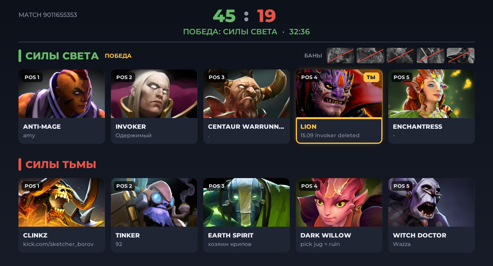

# Dota 2 Stats Bot

Telegram-бот, который отслеживает твои матчи в Dota 2 и после каждой игры присылает отчёт:
исход, длительность, герой и позиция, ранг и MMR, KDA / GPM / XPM / крипы / нетворс / нетворс на 10-й
минуте в сравнении со средним по твоему рангу, финальные предметы и картинку драфта.
Друзья подключаются сами: открывают бота, жмут /start и привязывают свой аккаунт.



## Что понадобится

1. **Python 3.11+**: https://www.python.org/downloads/ (при установке на Windows отметь «Add to PATH»).
2. **Токен бота**: напиши [@BotFather](https://t.me/BotFather), отправь `/newbot` и скопируй токен.
3. **Токен STRATZ** (бесплатно, нужен для средних по рангу): https://stratz.com/api. Войди через Steam
   и скопируй токен. Без него бот тоже работает, но вместо средних по рангу показывает процентили OpenDota
   («лучше 84% игроков на герое»).
4. Всем, кто пользуется ботом: в Dota 2 → Настройки → Социальные включить
   **«Общедоступная история матчей»** (Expose Public Match Data).

## Запуск

```bash
cd dota_bot
python -m venv .venv
.venv\Scripts\activate          # Windows
# source .venv/bin/activate     # Linux / macOS
pip install -r requirements.txt
copy .env.example .env          # Linux: cp .env.example .env
```

Открой `.env`, впиши `BOT_TOKEN` и `STRATZ_TOKEN`, потом:

```bash
python main.py
```

Проверить STRATZ (что токен рабочий и средние выглядят правдоподобно):

```bash
python check_stratz.py 74 2 65
```

## Команды

| Команда | Что делает |
|---|---|
| /start | регистрация (привязка Dota-аккаунта) |
| /last | отчёт о последнем матче |
| /match ID | отчёт о любом матче |
| /history | последние матчи списком (кнопка «Мои матчи»), по нажатию — отчёт |
| /friends | с кем играл за последний месяц: топ-5 друзей, игры вместе, винрейт |
| /profile | профиль, ранг, ссылки |
| /mmr 4200 | указать текущий MMR, дальше бот ведёт счёт (без него — примерный по медали) |
| /invite | ссылка, чтобы позвать друга |
| /unlink | отвязать аккаунт |
| /emoji | показать ID премиум-эмодзи |

## Премиум-эмодзи

С Bot API 9.4 бот может использовать премиум-эмодзи, **если у владельца бота есть Telegram Premium**.

- **Оформление** (кубок, монеты, графики и т.д.) — анимированные эмодзи из официального пака Telegram
  «Animated Emoji». Уже настроено, ничего делать не нужно.
- **Герои, предметы и медали** — бот сам создаёт свои паки эмодзи из иконок Dota 2
  (`dota_heroes1_by_<бот>`, `dota_items1_by_<бот>`, `dota_ranks1_by_<бот>`). Для этого впиши свой
  Telegram ID в `OWNER_ID` в `.env` (бот пишет его в лог, когда ты нажимаешь /start). Герои и медали
  загружаются в фоне при первом запуске (несколько минут), предметы — по мере появления в отчётах.
- Любой эмодзи оформления можно заменить: `/emoji` → пришли боту премиум-эмодзи → вставь ID в `emoji.json`.
  Если значок — слово из нескольких эмодзи (как WIN/LOSS), укажи список ID: `"win": ["id1", "id2"]`.
- **Кнопки** — с цветом и иконками из премиум-эмодзи. Если иконки не нужны: `BUTTON_ICONS=0` в `.env`.

Если Telegram не примет премиум-эмодзи, бот сам повторит отправку с обычными.

## Откуда данные и что приблизительно

- **Новые матчи**: ищутся через STRATZ (видит открытую историю сразу), запасной вариант — OpenDota.
- **Данные матча**: OpenDota. Сразу после игры бот просит OpenDota разобрать матч и ждёт до 25 минут: так
  появляются нетворс на 10-й минуте и линии. Если за это время разбор не готов, отчёт придёт без них.
- **Позиции**: точные из STRATZ (ролевой поиск). Без STRATZ бот определяет их по линиям и нетворсу и
  помечает «(≈)».
- **Средние по рангу**: STRATZ heroStats, по связке «герой + позиция + брекет ранга»
  (Рекрут–Страж, Рыцарь–Герой, Легенда–Властелин, Божество–Титан). Нетворс, крипы и XPM сравниваются
  со средними **на той же минуте игры**, поэтому длинные игры сравниваются честно.
- **MMR и ранг**: Valve не отдаёт изменение MMR через API. Бот считает ±25 за рейтинговую игру
  (`MMR_STEP`). Если указать MMR через `/mmr`, медаль считается по нему (например, 2400 = Герой I),
  иначе берётся медаль из последнего матча.
- **STRATZ** пускает с одного токена не больше 2 IP-адресов за 15 минут — не запускай бота в двух местах сразу.

## Лимиты

У бесплатного OpenDota около 2000 запросов в сутки. Бот проверяет игроков раз в 3 минуты, если они
недавно играли, и раз в 10 минут, если нет. Этого хватит на компанию из 4–5 друзей. Если вас больше,
возьми ключ OpenDota (`OPENDOTA_API_KEY`) или увеличь `POLL_IDLE` в `.env`.

## Хостинг 24/7 (Linux-сервер)

```bash
sudo apt update && sudo apt install -y python3 python3-venv git
# скопируй папку dota_bot на сервер, затем:
cd dota_bot && python3 -m venv .venv && .venv/bin/pip install -r requirements.txt
```

Автозапуск через systemd, файл `/etc/systemd/system/dotabot.service`:

```ini
[Unit]
Description=Dota 2 Stats Bot
After=network-online.target

[Service]
WorkingDirectory=/home/USER/dota_bot
ExecStart=/home/USER/dota_bot/.venv/bin/python main.py
Restart=always
RestartSec=10

[Install]
WantedBy=multi-user.target
```

```bash
sudo systemctl enable --now dotabot
journalctl -u dotabot -f     # логи
```

База пользователей хранится в `data/bot.db`. Её нужно сохранять при переносе на другой сервер.
